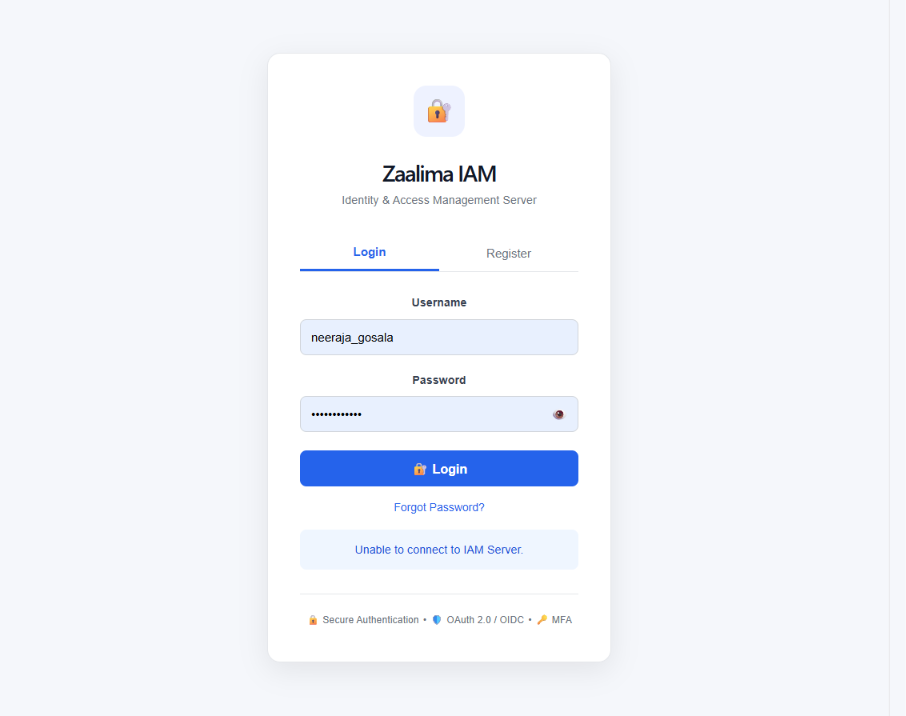

# Identity and Access Management (IAM) Server

## Project Overview

This project implements a centralized **Identity and Access Management (IAM) Server** using Spring Boot, Spring Security, Spring Authorization Server, PostgreSQL, Redis, React, and OAuth 2.0 / OpenID Connect.

The IAM server provides secure authentication and authorization services for applications through centralized identity management.

The project includes both a secure backend IAM server and a React-based frontend dashboard.

---

## Technologies Used

### Backend

* Java 17
* Spring Boot
* Spring Security
* Spring Authorization Server
* OAuth 2.0
* OpenID Connect (OIDC)
* PostgreSQL
* Redis
* JWT
* BCrypt Password Encoding
* TOTP Multi-Factor Authentication
* SendGrid Email OTP
* HTTPS / TLS
* Docker
* Docker Compose
* OWASP Dependency-Check

### Frontend

* React
* Vite
* JavaScript
* HTML5
* CSS3
* Fetch API
* Local Storage

---

# Main Features

* User Registration
* User Login
* BCrypt Password Hashing
* Role-Based Access Control (RBAC)
* Permission-Based Authorization
* OAuth 2.0 Authorization Server
* OpenID Connect
* Authorization Code Grant
* Client Credentials Grant
* Refresh Token Grant
* PKCE
* JWT Authentication
* Custom JWT Roles and Permissions Claims
* TOTP Multi-Factor Authentication
* Email OTP Verification
* Redis Session Management
* Token / Session Revocation
* Password Reset with OTP
* User Profile Management
* Audit Logging
* Rate Limiting
* HTTPS / TLS
* Docker Containerization
* React Frontend Dashboard
* Security Overview
* Account Overview
* Protected API Testing
* MFA Status Display
* Password Strength Indicator
* Show / Hide Password
* Forgot Password Flow

---

# System Architecture

The IAM Server acts as a centralized Identity Provider for applications.

```text
                         Client Application
                                |
                                | OAuth 2.0 / OIDC
                                v
                    +-------------------------+
                    |       IAM Server        |
                    |      Spring Boot        |
                    |  Spring Security / AS   |
                    +-------------------------+
                         |              |
                         v              v
                  +------------+    +---------+
                  | PostgreSQL |    |  Redis  |
                  +------------+    +---------+
                       |                 |
                   User Data         Sessions
                   Roles             OTP
                   Authorities       Token Sessions
```

---

# Security Components

```text
IAM Server
    |
    +-- Spring Security
    |
    +-- OAuth 2.0
    |
    +-- OpenID Connect
    |
    +-- JWT
    |
    +-- RBAC
    |
    +-- Permission-based Authorization
    |
    +-- TOTP MFA
    |
    +-- Email OTP
    |
    +-- Redis Session Management
    |
    +-- Audit Logging
    |
    +-- Rate Limiting
    |
    +-- HTTPS / TLS
```

---

# Project Structure

```text
iam-server/
│
├── src/
│   ├── main/
│   │   ├── java/
│   │   │   └── com/zaalima/iam_server/
│   │   │       ├── config/
│   │   │       ├── controller/
│   │   │       ├── dto/
│   │   │       ├── entity/
│   │   │       ├── repository/
│   │   │       ├── security/
│   │   │       ├── service/
│   │   │       └── util/
│   │   │
│   │   └── resources/
│   │       ├── application.properties
│   │       ├── templates/
│   │       └── iam-server.p12
│   │
│   └── test/
│
├── Dockerfile
├── docker-compose.yml
├── pom.xml
├── mvnw
├── mvnw.cmd
└── README.md
```

> Note: The PKCS12 certificate contains sensitive material and should not be committed to a public repository.

---

# Core Components

## 1. User Management

Users are stored in PostgreSQL with:

* Username
* Email
* BCrypt encoded password
* Account status
* MFA status
* Roles
* Authorities / permissions

---

## 2. Role-Based Access Control

The IAM server supports roles and authorities.

Examples:

```text
ADMIN
USER
READ
WRITE
```

Roles are mapped to authorities and are used for authorization.

Example:

```text
ADMIN
  |
  +-- READ
  +-- WRITE
```

The application uses Spring Security authorities to protect secured endpoints.

---

## 3. OAuth 2.0

The authorization server supports:

* Authorization Code Grant
* Client Credentials Grant
* Refresh Token Grant
* PKCE

A registered OAuth client is configured with the required authorization grant types and OAuth scopes.

---

## 4. OpenID Connect

OpenID Connect is enabled through Spring Authorization Server.

OIDC provides standardized identity information and discovery metadata.

### Discovery Endpoint

```text
https://localhost:8443/.well-known/openid-configuration
```

---

## 5. JWT Authentication

Authenticated users receive JWT-based authentication tokens.

Custom JWT tokens contain:

* Username
* Roles
* Permissions
* Issued time
* Expiration time

Example claims:

```json
{
  "sub": "username",
  "roles": [
    "ADMIN"
  ],
  "permissions": [
    "READ",
    "WRITE"
  ],
  "iat": "...",
  "exp": "..."
}
```

JWT tokens are validated before protected resources are accessed.

---

## 6. Multi-Factor Authentication

The system supports:

* TOTP-based MFA
* Email OTP verification

TOTP provides time-based authentication codes.

Email OTPs are generated securely and temporarily stored in Redis.

OTP characteristics:

* Six-digit OTP
* Secure random generation
* Five-minute expiration
* One-time usage
* Email delivery through SendGrid

---

## 7. Redis

Redis is used for:

* Login sessions
* OTP storage
* OTP expiration
* Session/token validation
* Token/session revocation
* Rate limiting counters

Login sessions are stored with an expiration time.

When a request contains a JWT, the server validates that the token matches the active Redis session.

---

## 8. Audit Logging

Important authentication and security events are stored in PostgreSQL.

Examples include:

```text
LOGIN
OTP_GENERATE
OTP_VERIFY
LOGOUT
RATE_LIMITED
```

Audit logging provides a record of important security-related activities.

---

## 9. Rate Limiting

Redis-based rate limiting protects authentication endpoints from excessive requests.

Rate limiting is implemented for:

* Login requests
* OTP generation
* OTP verification

Excessive requests are rejected with:

```text
HTTP 429 Too Many Requests
```

---

## 10. Password Reset

The system provides a secure password reset flow.

The process is:

```text
Username
   |
   v
Generate OTP
   |
   v
OTP sent through Email
   |
   v
User enters OTP
   |
   v
OTP Verification
   |
   v
New Password
   |
   v
Password Updated
```

The new password is stored using BCrypt password encoding.

---

## 11. HTTPS / TLS

The application runs over HTTPS using a PKCS12 certificate.

Application URL:

```text
https://localhost:8443
```

The development environment may display a certificate warning because a development/self-signed certificate is used.

---

# Frontend Application

The IAM Server includes a React-based frontend dashboard for interacting with the authentication and authorization services.

## Frontend Technologies

* React
* Vite
* JavaScript
* HTML5
* CSS3
* Fetch API
* Local Storage

---

## Frontend Project Structure

```text
iam-frontend/
│
├── src/
│   ├── App.jsx
│   ├── App.css
│   └── main.jsx
│
├── public/
├── package.json
├── vite.config.js
└── index.html
```

---

# Frontend Features

## Authentication

The frontend provides:

* User Registration
* User Login
* MFA Login
* Logout
* Authentication state
* Secure session handling
### User Login


---

## Multi-Factor Authentication

The frontend provides:

* TOTP MFA setup
* TOTP verification
* MFA-protected login
* MFA status display

---

## Password Management

The frontend provides:

* Forgot Password
* Email OTP generation
* OTP verification
* Password reset
* Password strength indicator
* Show / Hide password functionality

---

## IAM Dashboard

After successful authentication, the user can access the IAM dashboard.

The dashboard contains:

* Account Overview
* Username information
* Account status
* MFA protection status
* Last login information
* Security Overview
* Quick Security Actions
* Protected API testing
* Token/session status
* Logout functionality

---

# Frontend and Backend Integration

The React frontend communicates with the IAM backend through REST APIs.

### Backend Base URL

```text
https://localhost:8443
```

### Frontend Development URL

```text
http://localhost:5175
```

Architecture:

```text
React Frontend
      |
      | HTTPS / REST API
      v
IAM Server
      |
      +-- Authentication
      |
      +-- Authorization
      |
      +-- MFA
      |
      +-- OTP
      |
      +-- Password Reset
      |
      +-- JWT Authentication
      |
      +-- Redis Session Management
      |
      +-- PostgreSQL
```

---

# Frontend Screens

```text
Zaalima IAM
│
├── Login
│
├── Register
│
├── MFA Login
│
├── Forgot Password
│   ├── Username
│   ├── Send OTP
│   ├── OTP Verification
│   └── New Password
│
└── IAM Dashboard
    │
    ├── Account Overview
    │
    ├── Security Overview
    │
    ├── Quick Security Actions
    │
    ├── Protected API Test
    │
    └── Logout
```

---

# OAuth 2.0 / OIDC Endpoints

| Purpose             | Endpoint                            |
| ------------------- | ----------------------------------- |
| OIDC Discovery      | `/.well-known/openid-configuration` |
| Authorization       | `/oauth2/authorize`                 |
| Token               | `/oauth2/token`                     |
| JWK Set             | `/oauth2/jwks`                      |
| UserInfo            | `/userinfo`                         |
| Token Revocation    | `/oauth2/revoke`                    |
| Token Introspection | `/oauth2/introspect`                |
| Logout              | `/connect/logout`                   |

### Base URL

```text
https://localhost:8443
```

---

# REST API Endpoints

## Authentication

```text
POST /api/auth/register

POST /api/auth/login

POST /api/auth/login/mfa

POST /api/auth/logout

POST /api/auth/reset-password

GET  /api/auth/profile

GET  /api/auth/users
```

## OTP

```text
POST /api/otp/generate

POST /api/otp/verify
```

## MFA

```text
POST /api/mfa/setup

POST /api/mfa/verify
```

---

# Docker

The IAM application is containerized using Docker.

The project contains:

```text
Dockerfile
docker-compose.yml
```

The Docker configuration supports the IAM server together with PostgreSQL and Redis.

Architecture:

```text
Docker Compose
      |
      +-- IAM Server :8443
      |
      +-- PostgreSQL :5432
      |
      +-- Redis :6379
```

## Dockerfile

The backend uses Java 17:

```dockerfile
FROM eclipse-temurin:17-jre

WORKDIR /app

COPY target/iam-server-0.0.1-SNAPSHOT.jar app.jar

EXPOSE 8443

ENTRYPOINT ["java", "-jar", "app.jar"]
```

---

# How to Run the Backend

## Prerequisites

Install:

* Java 17 or later
* Docker Desktop
* Git
* Node.js and npm for the frontend

PostgreSQL and Redis can be provided through Docker Compose.

---

## Build the Application

On Windows:

```powershell
.\mvnw.cmd clean package -DskipTests
```

---

## Build the Docker Image

```powershell
docker build -t iam-server:1.0 .
```

---

## Start the Services

```powershell
docker compose up -d
```

Check running containers:

```powershell
docker ps
```

---

# Backend Application URL

```text
https://localhost:8443
```

---

# How to Run the Frontend

Navigate to the frontend project:

```powershell
cd C:\Users\neera\Downloads\iam-frontend
```

Install dependencies:

```powershell
npm install
```

Start the development server:

```powershell
npm run dev
```

The frontend is available at:

```text
http://localhost:5175
```

---

# Security Testing

The following security features were tested during development.

## Authentication

* User registration tested
* Login tested
* BCrypt password hashing verified
* JWT authentication tested
* Logout tested

## Authorization

* Role-Based Access Control tested
* READ authority tested
* ADMIN role authorization tested
* Protected API access tested

## OAuth 2.0

* Authorization Code flow configured/tested
* PKCE configured/tested
* Client Credentials flow configured/tested
* Refresh Token flow configured/tested

## OpenID Connect

* OIDC enabled
* OIDC discovery endpoint tested
* Discovery metadata successfully returned over HTTPS

## Multi-Factor Authentication

* TOTP setup tested
* TOTP verification tested
* MFA login tested
* Email OTP generation tested
* Email OTP verification tested
* OTP expiration implemented
* One-time OTP usage implemented

## Password Reset

* Forgot Password flow tested
* Email OTP generation tested
* OTP verification tested
* Password reset tested successfully

## Session and Token Management

* Redis session storage tested
* Session expiration implemented
* Logout/session deletion implemented
* JWT session validation implemented

## Audit Logging

Authentication and security events are stored in PostgreSQL.

## Rate Limiting

Rate limiting was tested for:

* Login
* OTP generation
* OTP verification

Excessive requests return:

```text
HTTP 429 Too Many Requests
```

## TLS

HTTPS was successfully tested using:

```text
https://localhost:8443/.well-known/openid-configuration
```

The OIDC discovery document was successfully returned over HTTPS.

---

# Dependency Security Scan

OWASP Dependency-Check was used to scan project dependencies.

The generated report showed:

```text
Vulnerable Dependencies: 0
Vulnerabilities Found: 0
```

The NVD update encountered an error during the scan, so the result should be considered a best-effort dependency assessment.

---

# Docker Services

| Service    | Port |
| ---------- | ---: |
| IAM Server | 8443 |
| PostgreSQL | 5432 |
| Redis      | 6379 |

---

# Environment Variables

Sensitive credentials should be provided through environment variables and should not be committed to source control.

Examples:

```text
SENDGRID_API_KEY
```

Other database, Redis, email, and security credentials should also be stored securely.

Do not commit real API keys, passwords, tokens, or other secrets to GitHub.

---

# Security Considerations

The project follows several security practices:

* BCrypt password hashing
* JWT validation
* Role-based authorization
* Permission-based authorization
* Redis-backed session validation
* OTP expiration
* One-time OTP usage
* Rate limiting
* HTTPS/TLS
* Audit logging
* Environment-based secret management
* Dependency security scanning

---

# Future Improvements

Possible production improvements include:

* Persistent OAuth2 registered clients
* Persistent RSA signing keys
* Production TLS certificates
* IP-based rate limiting
* Advanced multi-instance session coordination
* Centralized security monitoring
* Production email provider configuration
* Automated CI/CD security scanning
* Kubernetes deployment

---

# Conclusion

The Zaalima IAM Server provides a centralized authentication and authorization platform based on modern identity and security standards.

The project combines:

```text
Spring Boot
     +
Spring Security
     +
OAuth 2.0 / OIDC
     +
JWT
     +
PostgreSQL
     +
Redis
     +
TOTP MFA
     +
Email OTP
     +
RBAC
     +
Audit Logging
     +
Rate Limiting
     +
HTTPS/TLS
     +
Docker
     +
React Frontend
```

The system provides secure identity management, multi-factor authentication, role and permission-based authorization, session management, password recovery, security monitoring, and a user-friendly frontend dashboard.
